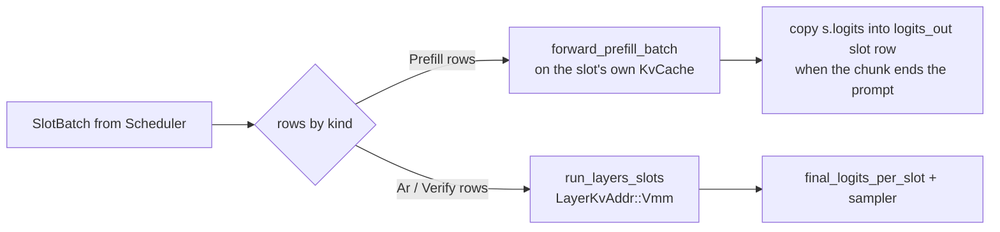

# VMM KV for the multi-slot serve engine — architecture and plan

**Lifecycle:** `planned` (design) / slices 0–3 `branch-implemented`, with the
smoke evidence in §11. This record is design + execution plan. It makes no
current-product claim and is **not** an acceptance pass: the
[`docs/VALIDATION.md`](../VALIDATION.md) routes (serve battery/chain, state
oracle) have not been run.

**Scope:** `serve.multi_slot` (`crates/hipfire-arch-qwen35/src/serve_engine.rs`,
`SlotEngine`) gains a VMM KV storage route (`--kv-backend vmm`) alongside its
current `SlotPool` arena route.

---

## 1. Goal and non-goals

### Goal

Let the multi-slot engine keep **per-request KV in VMM reservations** so that:

- physical KV is committed in proportion to what requests actually use, instead
  of `n_slots × cap_tokens` reserved at load;
- a slot's context bound (`serve.multi_slot_ctx` / `--max-seq`) no longer has to
  fit in VRAM for every slot simultaneously;
- the engine can admit a request only when its *own* KV fits, and refuse
  (retryable) instead of failing the load;
- KV addressing gets the `_vmm` descriptor's per-access device bound
  (`0 <= pos < mapped_positions <= logical_bound`); the arena descriptor's
  equivalent guard was removed for occupancy in SP1, leaving `positions[]` as
  the only causal bound.

### Non-goals (v1)

- **Rotated KV tiers.** `asym*` / `fwht*` / `bf16` / `f16` stay arena-only.
  `VmmKvFormat` has exactly `Q8` and `Fp8E4M3`
  (`crates/rdna-compute/src/attention.rs:259-278`), and the `_vmm` kernels
  assume one K/V per-token stride, which the rotated tiers do not have.
- **M-RoPE rows in the `_vmm` batched body.** Vision is served, but image
  requests run the sequential per-token VL path on their slot's own owner
  (§4.10); a *batched* VL step on the `_vmm` kernels is not implemented.
- **DFlash on VMM.** Its draft context ring is seeded from a batched-prefill
  hidden capture that this route's singleton prefill does not produce
  (MTP's head prefill uses the capture variant instead, §4.9).
- **Cross-session prefix cache under VMM** (radix index + `PagePool`). It
  requires paged KV (`serve_engine.rs:895-916`); the VMM equivalent is a
  separate design (§4.8), deferred.
- **Changing the per-request context bound semantics.** `cap_tokens` remains
  the bound; VMM changes *where the bytes live*, not the policy.

---

## 2. Current state

### 2.1 Two KV worlds in one process

| Route | Allocation | Addressing | Where |
|---|---|---|---|
| Multi-slot (arena) | one `SlotPool` slab (or `PagePool`) per KV layer, `n_slots × cap_tokens` up front | `KvSlotDesc` offsets into an arena tensor | `serve_engine.rs:1392-1437`, `rdna-compute/src/slot_pool.rs`, `rdna-compute/src/kv_slots.rs` |
| VMM batch / singleton | one `KvCache` VMM reservation per request | absolute VAs in `VmmKvSlotDesc` | `forward_slots/vmm.rs`, `saddle-core/src/kv.rs` |

The two never meet today: `Rig::build` rejects any non-legacy backend before a
single device allocation
(`serve_engine.rs:793-802`), and the daemon gate refuses it earlier
(`crates/hipfire-daemon/src/slots.rs:2060-2073`). `SlotLoadParams` defaults the
backend to `legacy` when the load request omits it
(`slots.rs:176`), which is why the arena route works despite
`KvBackend::default() == Vmm` (`crates/saddle-core/src/kv.rs:66-78`).

### 2.2 What the slots engine assumes about KV

- **One storage owner per slot.** `pool: SlotPool` + `k_arenas`/`v_arenas`
  (`serve_engine.rs:340-341`, `:1424-1437`); `slot_kv_view` builds a
  contiguous-slab `KvCache` view for the sequential VL writer
  (`serve_engine.rs:1993-2050`).
- **Provisioning is a page/frontier operation before the forward**:
  `pool.set_seq_len(slot, frontier)` plus the paged COW barrier
  (`serve_engine.rs:4352-4470`).
- **Capacity is a page count**: admission rejects at `cap_tokens`
  (`serve_engine.rs:5774+`), eviction frees *pages* (`:6671+`), and swap
  snapshots copy an arena slab / page list (`swap/snapshot.rs:227+`).
- **The decode graph is arena-addressed** and disabled under paged KV
  (`forward_slots.rs:3696`, key at `:3747-3761`).
- **The forward body is already storage-generic.** `LayerKvAddr` is an enum of
  `Arena { .. }` and `Vmm(VmmLayerKv)` (`forward_slots.rs:364-373`) and
  `run_layers_slots` takes a `Fn(kv_layer_idx) -> LayerKvAddr` closure
  (`forward_slots.rs:4411-4449`). `Qwen35VmmStore` already drives that closure
  with VMM descriptors (`vmm.rs:1698-1706`).

### 2.3 What the VMM stack already provides

- Per-request owners sized exactly like a template
  (`KvCache::from_mode_with_backend(.., KvBackend::Vmm, ..)`,
  `saddle-core/src/kv.rs:1301-1315`), growth with an admission budget
  (`vmm_admission_bytes` `:2290`, `provision_vmm_positions` `:2307`,
  `ensure_mapped_capacity` `:2209`), descriptor generation
  (`vmm_slot_descs` `:2348`, `vmm_owner_generation` `:2332`).
- Row-batched `_vmm` KV write and flash decode
  (`attention.rs:4092-4140`, `:4373`; host gate `validate_vmm_rows`
  in `kv_slots.rs`), plus a non-flash batched VMM attention
  (`attention.rs:4199`) whose use today is example-only.
- A complete VMM prefix capture/fork primitive that is **currently unused by
  product code**: `capture_vmm_prefixes` (`dispatch.rs:5525`),
  `fork_vmm_prefixes` (`:5682`), `free_vmm_prefixes` (`:5806`),
  `VmmSharedPrefix` / `map_shared_prefix` (`hip-bridge/src/vmm.rs:987`,
  `:1124`).
- Granule leases + retired-VA accounting, cap 64 TiB
  (`hip-bridge/src/vmm.rs:27-59`).

The VMM batch route is the proof of concept: per-request owners, one shared
trunk, descriptor-addressed steps, with a state oracle already accepted for
that route (`examples/cb_vmm_state_oracle.rs`,
`docs/VALIDATION.md:357`).

---

## 3. Considered architectures

**A. Storage enum inside `SlotEngine` (selected).** Keep the engine's
scheduler, sessions, HTTP surface and forward body; add a second storage
implementation (per-slot VMM owners + descriptor tables) and select it at
`Rig::build`.

**B. VMM-backed `SlotPool` arena.** Reserve one huge VMM arena per layer and
map granules as the pool "allocates" pages. Rejected: page→VA assignment is
arbitrary in `PagePool`, but `VmmArena` maps *next* (or a whole shared prefix
at base, `vmm.rs:1124-1134`). Supporting scatter needs a new arena API, and a
slab pool would fragment the monotone frontier.

**C. Run slots on `Qwen35VmmStore`.** Delete `SlotEngine`'s KV and delegate to
the batch store. Rejected for v1: the store's planner/batch shape
(`BatchStepPlan`) is a different engine, and the slots engine owns features
the store does not (structured output, VL batching, eviction to host swap,
session continuation, tool-reentry). Reusing its *primitives* (descriptors,
row-batched decode, admission math, exact prefill) is the plan; reusing its
*control loop* is a later consolidation, not a prerequisite.

---

## 4. Selected architecture

### 4.1 Storage type

```rust
// serve_engine.rs (or a new `slot_kv_vmm` module)
enum SlotKvStorage {
    Arena(ArenaKv),   // SlotPool + k/v arenas + SlotDescStaging  (unchanged)
    Vmm(VmmKv),       // per-slot KvCache owners + descriptor tables (new)
}

struct VmmKv {
    format: VmmKvFormat,             // Q8 | Fp8E4M3
    kv_layer_ids: Vec<usize>,        // model layer index of each FA layer
    owners: Vec<Option<KvCache>>,    // n_slots, one per slot (stable, reused)
    slot_len: Vec<usize>,            // logical positions written per slot
    reserve_end: Vec<usize>,         // mapped-prefix guarantee per slot
    descs_dev: Vec<GpuTensor>,       // [n_fa_layers] × [n_slots × 32 B]
    descs_host: Vec<VmmKvSlotDesc>,  // layer-major: l * n_slots + slot
    row_slot_dev: GpuTensor,         // [max_batch] i32
    flash_partials: GpuTensor,       // fixed 256 MiB (vmm.rs:129-132)
    kv_budget_bytes: usize,          // engine-wide mapped-byte ceiling
    mapped_high_water: usize,
}
```

`owners[s]` is created **lazily at the slot's first admission** and then kept
for the engine's lifetime. Rationale in §4.2.

### 4.2 Owner lifecycle — one owner per slot, never per request

`VmmArena::release` never returns VA; released ranges are retired against a
64 TiB process cap (`vmm.rs:27-59`). At a 27B-class shape, one slot's owner is
≈`cap × n_fa_layers × 2 × bytes_per_token` of VA (e.g. Hkv4/D256 Q8 =
2,176 B/token/layer; 16 FA layers × 8,192 tokens ≈ 285 MB — arithmetic from
`VmmKvFormat::bytes_per_token`, `attention.rs:270-278`). Allocating per request
would burn ~1.1 GB of VA per 4-slot cycle and eventually refuse reservation with
"restart the process to reclaim it".

Therefore:

- create the owner on first admission (not at load — VA is cheap, but a model
  that never serves should not reserve it);
- **reuse it for every later request in that slot**, resetting `slot_len` to 0;
- free owners only in `Rig::free_gpu` / engine teardown.

Consequences, stated plainly:

- A slot's *mapped* physical bytes are a high-water mark and are not returned
  when its request ends. This is slab-equivalent (the arena route never returns
  KV either) but the high-water tracks actual use, not `cap_tokens`.
- Eviction frees the *slot*, not its mapping. The slab route behaves the same
  way; the paged route is the only one that returns memory, and it pays for
  that with page tables. A reclaim mode is future work (§4.8/§10).

### 4.3 Capacity and admission — reserve-then-map, never map mid-step

The VMM batch route maps inside `provision_step` and can refuse a request mid
conversation (`vmm.rs:1461-1489`). The slots engine must preserve its stronger
guarantee — *an admitted request never OOMs a step* — so:

1. At admission, compute
   `reserve_end = prompt_len + max_tokens + VMM_RESERVE_SLACK_ROWS`
   (`VMM_RESERVE_SLACK_ROWS = 64`, `vmm.rs:134-137`) and map to it with
   `provision_vmm_positions(gpu, reserve_end, budget)`.
2. `budget = min(kv_budget_bytes − mapped_total, vmm_map_room(device_free, pool_parked))`
   (`vmm.rs:142-146`).
3. Refusal is **retryable overload** (same class the paged route uses at
   `serve_engine.rs:4352-4390`), after attempting one LRU eviction.
4. No call site may grow a mapping during a step. The forward body's own
   `ensure_mapped_capacity` calls
   (`qwen35/prefill.rs:3216`, `mtp_spec.rs:2550`) become no-ops because the
   reservation already covers the step.

`kv_budget_bytes` is computed once in `Rig::build` from the same device census
the arena route uses, but **without** charging the arena's `kv_bytes`: weights +
scratch + a reserve, then
`kv_budget = free − planned_non_kv − VMM_MAP_DEVICE_RESERVE_BYTES`. The R9700
32 GB deployment-target check in `preflight_alloc`
(`rdna-compute/src/kv_slots.rs`) still runs, with the smaller planned number;
admission is what enforces the rest.

### 4.4 Steady-state step

Per step, per slot, the scheduler is unchanged (`Scheduler::next_batch_eligible`
is storage-independent, `runtime/src/scheduler.rs:189-216`). The storage split:



- **Plain prompt rows run batched** through the same `run_layers_slots` /
  `LayerKvAddr::Vmm` body as decode. `positions[]` is the causal authority and
  `final_logits_per_slot` produces each slot's final-row logits. MTP/DFlash
  prompt chunks stay on the singleton `forward_prefill_batch` body because
  their private hidden capture is not ported to the batched pass yet; MoE/A3B
  prompt chunks stay singleton because the `_vmm` batched prefill path is not
  validated for those branches (a 35B-A3B run hung before sampling). Those are
  the serialized prefill cases. The batched path needs zero new
  kernels (the `_vmm` kernels already serve prefill rows). Equality with a
  serial `hipfire run` is still not a gate: chunk boundaries are the slots
  scheduler's, and row-count-dependent kernels make byte equality across
  compositions false on both storage routes. The gate remains request
  isolation plus batch determinism (I9), with VMM-vs-arena concurrent text
  compared byte for byte at the same batch composition.
- **Decode and speculative verify run batched** through `run_layers_slots`
  with `LayerKvAddr::Vmm` — the same closure `Qwen35VmmStore::run_pass` builds
  (`vmm.rs:1698-1706`), using row-batched flash decode
  (`vmm.rs:305-330`, `attention.rs:4373`), which the kernel header documents as
  serving "decode, linear verify and prefill rows alike"
  (`attention.rs:4194-4198`).
- `SlotKvTier` for VMM is `{ mode: Q8 | Fp8, givens_*: None, fwht_*: None }`
  (`vmm.rs:1680-1686`); rotation tables are not allocated for this route.
- Host epilogue: `slot_len[s] = frontier` after the step (replacing
  `advance_slot_seq_lens`, `forward_slots.rs:4005`); no descriptor rewrite
  is needed because descriptor contents are **admission-constant** (§4.5).

This split follows `VmmRoute::Exact` (`vmm.rs:692-702`) rather than
`Nonexact`, and it is the reason the plan can promise per-request equivalence.

### 4.5 Descriptor tables and host validation

- `descs_host[l * n_slots + slot] = owner.vmm_slot_descs(gpu)[layer]`;
  idle slots hold `VmmKvSlotDesc::MASKED`
  (`vmm.rs:1496-1527`, `kv_slots.rs`).
- Because `mapped_positions`, `logical_bound`, `k_base`, `v_base` and
  `owner_generation` are all fixed once the owner is created and reserved, the
  whole table is uploaded **at admission**, not per step. That is strictly
  cheaper than the batch route's per-step upload with its coalescing mirror
  (`vmm.rs:1573-1593`) and removes a per-step hazard from graph replay.
- **Add an epoch-aware host gate.** `validate_vmm_rows` binds a row to the
  *owner generation* (`kv_slots.rs`), which is constant for a stable
  per-slot owner and therefore cannot catch slot reuse. The slots route must
  additionally assert, per row: `row_slot[row] == expected_slot` and
  `epoch == slot_epoch[expected_slot]`, mirroring the plan checks in
  `provision_step` (`vmm.rs:1400-1450`). Implement as
  `validate_slot_vmm_rows(descs, row_slot, positions, slot_epoch)` in the same
  module as the planner, and keep `validate_vmm_rows` underneath.

### 4.6 Graph capture

- The decode graph is a per-shape `hipGraph` over the slots body
  (`forward_slots.rs:3670-3830`). VMM descriptor tables and owners have stable
  VAs, and §4.3/§4.5 forbid mapping or table rewrites mid-step, so capture is
  sound. `ctx_bucket` must use `cap_tokens` (the owner's `physical_cap`), not
  `pool.cap_tokens()` (`forward_slots.rs:3749-3761`).
- Add `storage: Arena | Vmm` to `DecodeGraphKey` so the two routes can never
  replay each other's exec; the engine is one route per load, so this is a
  cheap invariant keeper.
- `rewind_slot_seq_lens` needs a VMM twin (host `slot_len` only).
- **Ship decode capture in a later slice than the functional route** (§6), with
  `HIPFIRE_VERIFY_GRAPH`/`HIPFIRE_GRAPH` eyeball runs, because the graph
  failure class in this repo is "plausible tok/s, garbage output".

### 4.7 Snapshot, swap, session continuation

`SnapshotStamp` and the payload layout (per FA layer: K span then V span, then
DN state) are storage-agnostic (`swap/snapshot.rs:42-68`, `:227+`). The VMM
capture is *simpler* than paged: each owner tensor is a linear reservation, so
each layer/side is one `memcpy_dtoh` of `seq_len × stride` from the tensor base
(no page walk). `restore_slot` writes back the same way.

- `stamp.cap` becomes `cap_tokens` (unchanged value), `per_pos_bytes`
  becomes `format.bytes_per_token(..)` for both sides (Q8 and Fp8 share it —
  `attention.rs:270-278`), `kv_dtype_tag` gains a backend bit so a snapshot can
  never be restored across routes.
- Session continuation (resident slot) works unchanged: `slot_len[s]` and the
  owner bytes are the state. The prefill guard
  (`extended.len() + max_tokens > cap_tokens`, `serve_engine.rs:5910-5960`)
  gains the admission mapping step before prefill.
- MTP head-KV is not in the snapshot today ("swap-restore loses the head KV",
  `serve_engine.rs:5874-5884`) — unchanged; the restore path already resets MTP.

### 4.8 Prefix cache (implemented: host snapshot LRU)

The arena route shares 128-token physical pages through `PagePool` and a radix
index (`serve_engine.rs`). VMM has no page table. The selected v1 design is a
bounded **host-snapshot LRU** (`serve_vmm_prefix.rs`), not a `PagePool` shim:

- an entry is `(token prefix, SlotSnapshot)` where the snapshot is exactly
  `VmmSlotKv::capture_slot`'s payload — per-FA-layer KV prefix plus the
  DeltaNet state at the same boundary;
- capture happens after a successful prefill chunk, only while a suffix
  remains (a full-prompt snapshot has no logits to continue from), via the
  per-slot `vmm_prefix_mark` watermark so an idle step does not recopy;
- a cold request looks up the longest cached token prefix that validates
  against the current `SnapshotStamp`, restores KV **and** recurrent state
  into its own owner, publishes `pool.set_seq_len(n)`, and prefills only the
  suffix. A failed restore resets the state and discards the entry; it never
  leaves a half-restored prefix paired with a cold prefill;
- retention is bounded by `serve.prefix_cache_max_bytes`; eviction is LRU.
  Nothing is shared physically and no VA is retired: no owner churn, no graph
  invalidation beyond the normal request boundary;
- `reused > 0` retires MTP/DFlash for the turn (their private KV was not
  prefilled), matching the arena radix rule.

Measured on a 981-token prompt with a 256 MiB ceiling: entries at 512 and 896
tokens (48/103 MiB), a warm request reused 896 tokens, greedy text was
byte-identical to a cache-disabled cold control, and a different-prefix
request missed. See §12.5.

**Future (not v1):** physical sharing via `capture_vmm_prefixes` /
`fork_vmm_prefixes` and `map_shared_prefix`. It is a different trade — shared
physical bytes for VA churn and per-hit owner recreation — and should be
decided on measured host pressure, not assumed. The host-snapshot cache is
the correct baseline: it cannot alias, cannot cross a stamp, and does not
retire VA.

### 4.9 MTP and DFlash

Both are already VMM-compatible in principle: the store installs
`VmmSpecEngine` / `VmmDflashEngine` and verifies through the same batched body
(`vmm.rs:676-687`, `:1614`). Requirements for the slots route:

- verify rows stay inside `reserve_end` (the 64-row slack covers MTP `k+1` and
  a DFlash block up to 63);
- the spec verify tape and per-slot DN snapshot are untouched
  (`serve_engine.rs:1651-1660`, `:2499-2510`);
- partial-accept repair writes `slot_len` only (§4.4), never a mapping.

**MTP is implemented on this route.** The forward splits prefill (singleton)
from decode/verify (batched), so the engine cannot derive a slot's verify-row
offset from the step's original `SlotBatch`. `forward_step_vmm` records
`vmm_row_offsets[slot]` each step (decode-batch offset, 0 for a prefilling
slot, `usize::MAX` when absent); the accept step reads `pbs.x_batch` through
it and the MTP head prefill uses the chunk's captured post-norm hidden rows
(`forward_prefill_batch_capture_hidden`, fed to the head without a second
norm). The verify tape is captured by the batched decode pass exactly as on
the arena route.

**DFlash is implemented on this route.** `dflash_prefill_chunk` needs the
*pre-norm* trunk hidden of the prompt chunk (the batched body's `x_batch`),
which the singleton prefill previously did not write. The singleton prefill
now accepts an extract-layer capture
(`forward_prefill_batch_capture_extract_hidden`): each internal chunk copies
the extract layers' post-layer residual rows to the shared staging buffer at
the chunk's absolute row, so a prompt split by the arch chunk ceiling still
lands contiguously. `VmmSlotKv::prefill_chunk` selects that capture for a
DFlash-armed slot (MTP keeps the post-output-norm capture), and
`dflash_prefill_chunk` scatters from staging row 0. Verify rows use the same
`SpecVerifyCapture` as the arena route. A legacy DFlash draft (no candidate
selector) is still refused by `load_dflash_shared`, as on the arena route.

### 4.10 Vision (sequential VL on the slot owner)

A vision model (`is_vl` or a `.vl` sidecar, `vision_mode=on`) is admitted on
the VMM route. Image requests run the engine's existing sequential per-token
VL path — M-RoPE phases, visual-embedding splice, the vision tower — and that
path's "slab view" is `VmmSlotKv::slot_view`: a `KvCache` of shallow tensor
clones over the slot's own reservation. Writes therefore land in the slot's
VMM owner, `ensure_mapped_capacity` maps that owner, and the text route stays
batched. The scheduler already holds VL slots out of the batched body when the
sequential path owns them; the trade-off is the documented one — the tower
encode runs inline on the engine thread (4.5 s for a 34×34 grid) instead of
being interleaved one layer at a time, and a VL request never speculates
(`mtp_ok` requires `visual_data.is_none()`, both admit arms).

A **text continuation of an image conversation** also needs M-RoPE phases
(`pos + rope_delta`), and the `_vmm` kernels have no M-RoPE writer. The engine
routes exactly that turn through the same sequential body: a `VlPrefill` with
an empty patch list (nothing to encode) and the session's `rope_delta`; the
scheduler's per-row `pos3_delta` is zeroed so other slots keep 1D steps. Plain
text turns (delta 0) stay batched.

q8 only: the sequential writer's kernels are the q8 flat path, so
`fp8 + vision` fails the existing `vl_sequential && !Q8` gate.

### 4.11 Control plane

- `--kv-backend vmm` already flows `serve --kv-backend` →
  daemon load params (`cli/serve/mod.rs:1281`, `:1285-1287`) and
  `bench --backend slots` → `experimental_multi_slot`
  (`cli/main.rs:6581-6585`).
- Daemon gate (`slots.rs:2060-2073`) becomes: `vmm` is admitted iff
  `kv_mode ∈ {q8, fp8}`, `fp8 ⇒ gfx1201`, `!is_vl`, and the
  engine's own `Rig::build` re-checks all of it fail-closed (house style, cf.
  `serve_engine.rs:793-802`).
- Loaded ack gains `slot_kv_backend: "vmm"`, `slot_kv_format`,
  `kv_budget_bytes`, and the engine reports `mapped_kv_bytes` /
  `mapped_high_water` after each step (the VMM analogue of
  `EngineStats::pool_free_pages`, `runtime/src/serve/mod.rs:225-232`).
- Default stays `legacy` when the request omits `kv_backend` (§2.1). No silent
  flip: the VMM route is opt-in in v1.

### 4.12 Teardown

`Rig::free_gpu` (`serve_engine.rs:1876+`) frees owners through
`Gpu::free_tensor` (`dispatch.rs:6346-6390`), then drains the pool. The
transactional `Guard` in `Rig::build` must own owners too, so a failed load
frees whatever was created (pattern at `serve_engine.rs:1300-1374`).

---

## 5. Invariants (each is a test)

1. **I1 — no mapping inside a step.** All `hipMemMap` calls for a slot happen
   in admission, before any forward or graph capture. Asserted by a debug
   counter (`mapping_calls_during_step == 0`).
2. **I2 — owner stability.** `owner_generation(slot)` never changes for the
   engine's lifetime (until teardown). Asserted across a 200-request soak.
3. **I3 — descriptor constancy.** For a live request, the uploaded descriptor
   bytes for its slot never change after admission.
4. **I4 — epoch binding.** A row whose `row_slot` names an idle slot, or whose
   epoch is not the slot's current epoch, is refused before any launch (§4.5).
5. **I5 — reservation covers the request.** Every write position in every step
   satisfies `pos < reserve_end` and `pos < mapped_token_capacity()`.
6. **I6 — no VA churn.** `retired_va_bytes()` is unchanged across request cycles
   on one engine.
7. **I7 — budget.** `mapped_kv_bytes + outstanding reservations ≤ kv_budget_bytes`,
   and a refusal is a typed `Overload` rejection, never a HIP OOM.
8. **I8 — route isolation.** The same model + settings on `legacy` and `vmm`
   both load and serve; a VMM snapshot is refused by a legacy engine and vice
   versa (stamp tag).
9. **I9 — request isolation and batch determinism.** With identical prompts and
   greedy sampling, two concurrent VMM-slot requests that share a prompt produce
   identical text (neither reads the other's KV), and repeating a run with the
   same batch composition reproduces it. The route does **not** promise equality
   with the sequential `hipfire run` route: decode always uses the row-batched
   `_vmm` kernels, and projection arithmetic is row-count dependent (the arena
   route has the same property). Measured on gfx1100 / Qwen3.5-0.8B: VMM
   concurrent text is byte-identical to arena-legacy concurrent text for the
   same prompts, while both differ from their own serial runs at some token.

---

## 6. Implementation slices

| # | Slice | Files | Acceptance |
|---|---|---|---|
| 0 | Contract + gates + ack fields; no behavior change | `serve_engine.rs` (`Rig::build`, `EngineConfig`), `daemon/slots.rs` (`validate_load_caps`, `SlotLoadParams`), `runtime/src/serve/mod.rs`, `CONFIG.md`, `SERVE.md`, `env-vars.md` | `legacy` loads byte-identically; `vmm` with rotated tier / VL / fp8-off-gfx1201 gets the named refusal; unmodified `test_serve_concurrent` passes |
| 1 | `SlotKvStorage` enum + `VmmKv` (owners, tables, budget, admission mapping, release) | new `slot_kv_vmm.rs`, `serve_engine.rs` | unit: reservation math, desc packing/MASKED idle slots, budget refusal; load-time `Guard` cleanup test |
| 2 | VMM forward: decode rows batched + singleton prefill + host epilogue | `serve_vmm.rs` (`prepare_step`/`step_body`), `serve_engine.rs::forward_step_vmm` | isolation + composition determinism oracle (`test_slots_vmm_oracle`), coherent output — **branch-implemented, measured (§11)** |
| 3 | Lifecycle: swap capture/restore, eviction, continuation, reset/close, MTP/DFlash | `serve_engine.rs`, `swap/snapshot.rs` (VMM capture helper), `checkpoint.rs` untouched | swap-out/in continuation identical; eviction admits a new request; MTP and DFlash oracles; soak I2/I6/I7 |
| 4 | Graph capture for VMM decode | `serve_vmm.rs` (own cache/key), `serve_engine.rs` (stats) | `HIPFIRE_SLOTS_DECODE_GRAPH=1`: capture/replay counts > 0, ids identical to graph-off; I1/I3 hold — **branch-implemented, measured (§11)** |
| 5 | Prefill throughput closure | `serve_engine.rs` (`forward_step_vmm`) | **implemented**: dense prompt rows batched through `_vmm`; MTP/DFlash and MoE prefill stay singleton. 4-lane 953-token prompt TTFT within run spread of legacy (see §12.5); no new kernel |
| 6 | VMM prefix cache | `serve_vmm_prefix.rs`, `serve_engine.rs` | **implemented**: host-snapshot LRU; `check_slots_vmm_prefix.py` hit + negative + warm==cold; no VA churn (§12.5) |

Slices 1–4 are the shippable v1. Slice 5 is a perf gate: if the singleton
prefill costs more than the arena route on the target workload, v1 either ships
with that documented or waits for the kernel. Slice 6 (host-snapshot cache) is
implemented and measured; physical granule sharing remains a future optimization
(§4.8).

---

## 7. Validation

Route selection per [`docs/VALIDATION.md`](../VALIDATION.md): this touches serve,
KV backend, dispatch and (slice 4) graph capture.

1. **State oracle (new example).** Model it on
   `examples/cb_vmm_state_oracle.rs` (k=1..4/8, unequal prompts, contexts
   512 / 8,192 / 32,768, 256 greedy steps, request-unique prompts so cross-slot
   reads are visible). Assert:
   (a) two concurrent requests with the same prompt emit identical ids;
   (b) the same batch composition repeated emits identical ids;
   (c) VMM concurrent text equals arena-legacy concurrent text for the same
   prompts (proves the storage route changes nothing about batching). Do not
   assert equality with the sequential route — row-count-dependent kernels
   make that false on both storage routes.
2. **Negative controls.** Force a wrong slot in `row_slot` → refused by I4; a
   stale epoch → refused; a position beyond `mapped_positions` → host refusal
   (and a device trap if launched); an over-budget admission → typed Overload.
3. **Serve battery/chain** via `scripts/serve_harness.py` on the pinned fixture
   with multi-slot enabled, plus `scripts/serve_harness.py --concurrent-clients 1,2,4`
   for exactly-once terminals and per-client isolation; eyeball decoded text.
4. **Lifecycle:** force `host_budget_bytes` small enough to evict, then continue
   the swapped session (the `test_serve_prefix_cache` pattern,
   `crates/hipfire-runtime/examples/test_serve_prefix_cache.rs`); 200-cycle soak
   for I2/I6/I7.
5. **Spec:** MTP `on` and DFlash `on` oracle runs, greedy, with a baseline
   `--spec off`; verify rows near the cap (`reserve_end`) and partial accepts.
6. **Perf:** `hipfire bench --backend slots --kv-backend vmm` vs
   `--kv-backend legacy`, committed prompt files with md5s, 3 fresh processes,
   model + both binary md5s; report prefill and decode separately because the
   prefill strategy differs; no claim from a single run.
7. **Graph (slice 4):** graph-on vs graph-off token equality plus a
   `HIPFIRE_VERIFY_GRAPH` run; read the output, not just tok/s.

---

## 8. Risks

| Risk | Consequence | Mitigation |
|---|---|---|
| Prefill not batched (singleton route) | long prompts cost more wall-clock than the arena route at equal slots | measure in slice 5; add `_vmm` prefill tile kernel or make the trade-off explicit in docs |
| Sticky per-slot mapping | a slot's high-water is not reclaimed; fragmentation vs slab | admission uses remaining capacity; document; reclaim mode explicitly future |
| Rotated KV unavailable | users on `fwht3`/`asym3` cannot use VMM slots | named refusal; the arena route remains the default |
| Descriptor table upload at admission only | a stale table after a slot is re-admitted | table rewritten on every admission; I3 asserted; idle slots MASKED |
| Graph capture with VMM | silent wrong KV addresses (the repo's worst class) | mapping/table writes only before capture; storage tag in the graph key; graph-off oracle first, graph slice separate |
| Retired VA if a reclaim mode is added | process-wide reservation refusal after heavy churn | keep one-owner-per-slot; make reclaim opt-in with a measured VA budget |
| Fp8 path is gfx1201-only and less exercised | mis-reads on other arches | existing arch gate (`serve_engine.rs:971-979`) reused |

---

## 9. Rollback

`kv_backend` stays a per-load selector. Reverting is
`--kv-backend legacy` (or `serve.multi_slot` unchanged with the default
backend); no on-disk format, registry entry, or config default changes in v1.
Slice 0 alone is a behavior-preserving change and can ship independently.

---

## 10. Open decisions

1. **Default backend for multi-slot after v1 stabilizes** — keep `legacy` until
   the oracle, soak and perf gates all pass; then a separate decision record.
2. **Reclaim mode** (free the owner at request end to return VRAM) — accept VA
   churn against the 64 TiB cap, or add an owner freelist with explicit
   generation bumps. Only worth doing if a workload shows sticky-high-water
   fragmentation.
3. **Prefix cache** — **decided for v1:** bounded host-snapshot LRU (§4.8),
   measured by `check_slots_vmm_prefix.py`. Physical granule sharing remains a
   future optimization, gated on measured host-memory pressure and hit rate.
4. **Consolidation** — once VMM slots ships, the VMM batch store and the slots
   engine share nearly everything except the control loop. A follow-up record
   should decide whether they converge.

---

## 11. Branch implementation record (2026-10-22)

Backend reporting: slot loads now publish the effective backend from the load
request (`ResidentKvDiag::for_slot(Option<KvBackend>)`); before this fix the
daemon hardcoded legacy for every slot load, which emitted the
`WARNING HIPFIRE_KV_BACKEND=legacy` disclosure and reported
`kv_backend: "legacy"` in the loaded ack even on the VMM route.

What landed (slices 0–3 of §6): `SlotKvStorage` equivalent as
`serve_vmm::VmmSlotKv` (per-slot owners, descriptor tables, admission-time
mapping, budget accounting, flat snapshot capture/restore), the build gates and
daemon capability gate, the VMM forward split (singleton prefill + `_vmm`
batched decode), and the lifecycle hooks (admission, continuation, eviction,
restore, reset, teardown, `EngineStats::mapped_kv_bytes`). Speculation is
deferred on the route (`auto` declines with one line, explicit `on` fails the
load); slices 4–6 (graph capture, prefill kernel, prefix cache) are not started.
*Historical note:* §12 supersedes this paragraph — graph capture, MTP/DFlash,
post-image continuation and the host-snapshot prefix cache are implemented and
measured; slice 5 (batched prefill) remains the open performance decision.

### Measured

Environment: gfx1100 (RX 7900 XTX), HIP 7.16, release build of this branch,
`hipfire` and `daemon` built from the same tree. Fixture
`qwen3.5-0.8b.mq4` (sha256 `aedfe31be68213dbcd13cff3a63ba150c330d0d0547df30f2c629e76ab5dda39`),
q8 KV, `serve.multi_slot_ctx=2048`. The host had ~2.8 GB free VRAM (a root-owned
unrelated daemon held ~21 GB), which is why the 0.8B fixture was used; **no
larger model or second arch was exercised, and nothing here is a perf claim.**

1. **Load + concurrency sweep** (`hipfire bench --concurrency 1,2,4 --backend slots
   --kv-backend vmm`): load logs `slot KV tier Q8 on vmm: 4 slots x cap 2048
   tokens, mapped-byte budget 666 MiB`; k=1/2/4 each finish 64/64 tokens with
   0 errors (stateless arm). Multiturn arms are marked `[invalid]` by the harness
   because prefix reuse is off on this route — expected.
2. **Request isolation + route equivalence.** Same prompt, greedy: two concurrent
   requests emit identical text; a repeat emits the same text; VMM concurrent
   text is **byte-identical to arena-legacy concurrent text** for both prompts
   tested. Serial vs concurrent differs on both routes (`add` at char 19 on VMM,
   110 on legacy), which is the documented row-count-dependent-kernel behaviour,
   so I9 is isolation/determinism, not equality with the sequential route.
3. **Swap capture/restore.** Two slots, three conversations: slot trace shows
   `residency=Swapped` for the evicted session, a subsequent
   `continuation HIT`, and coherent on-topic replies for all three follow-ups.
   This exercises `capture_slot` → `SwapManager::park` → `restore_slot` on the
   VMM layout.
4. **Fail-closed gates.** `--kv-mode fwht3 --kv-backend vmm` → daemon refusal
   naming q8/fp8; `serve.prefix_cache` + vmm → engine refusal naming the page
   pool; serve exits 1 in both cases (multi-slot prewarm fails closed).

### Second run — 4B fixture, decode graph (2026-10-22)

Host VRAM was free for this run. Fixture
`~/models/hipfire/Qwen/Qwen3.5-4B-MQ4/qwen3.5-4b.mq4` (2,587,047,936 B, the
caller's local copy), gfx1100, q8, 2 slots × 1024 ctx.

5. **Oracle** (`crates/hipfire-runtime/examples/test_slots_vmm_oracle.rs`,
   arena then VMM in one process, 2 prompts, serial ×2 + burst ×2):
   graph off — both routes' serial and burst repeats are identical, VMM
   first-token isolation holds, and the VMM burst ids equal the arena burst ids
   lane-for-lane (`[true, true]`). Graph on
   (`HIPFIRE_SLOTS_DECODE_GRAPH=1`) — arena and VMM each 5 captures / 132
   replays, and a dump-diff against the graph-off arm shows **identical ids on
   both routes** (graph is output-neutral).
6. **Service sweep, 4 slots** (`hipfire bench ... --concurrency 1,2,4
   --backend slots --kv-backend vmm`): stateless k=1/2/4 each 64/64 tokens,
   0 errors, and the same `text_md5` (`94f1d7c2…`) at every k — batch
   composition did not change output on this fixture. (This sweep binary
   predates the VMM graph slice, so its `HIPFIRE_SLOTS_DECODE_GRAPH=1` affected
   only the arena route; the VMM graph evidence is items 5 and 8.) The multiturn arm's k=1 point completed 128/128; at k=2 the daemon
   exit surfaced as `Broken pipe`. Attribution: the **legacy control dies at
   the identical point** (`conversation 12`, same broken pipe), and an earlier
   identical run was OOM-killed by the kernel (`dmesg`: `oom-kill … task=daemon`,
   anon-rss 6.0 GiB) on this 7.1 GiB host — so that abort is a host-memory
   limit of this box, not the VMM route (the route also releases memory by
   deferring MTP). A serve-level reproduction with 4 concurrent lanes × 2 turns
   on the same model and graph setting completed with `/health` ok.
7. **Fail-closed gates** measured earlier on the 0.8B fixture still hold
   (they run before any allocation).
8. **Rebuilt binary, graph on** (`HIPFIRE_SLOTS_DECODE_GRAPH=1`,
   `hipfire serve` multi-slot + vmm, 4 slots × 2048): two serial runs identical,
   two concurrent identical-prompt lanes identical, decoded content well-formed,
   `/health` ok with the graph build — the daemon path exercises the same
   `SlotEngine` the oracle drives.

Slice 4 (decode graph) is therefore branch-implemented and measured on the VMM
route. Slice 5 (prefill kernel) and 6 (prefix cache) are untouched.

9. **Vision + MTP on the same VMM serve** (4 slots × 2048,
   `--kv-backend vmm --kv-mode q8 --vision qwen3.5-4b.vl --spec mtp`,
   `HIPFIRE_VISION_MODE=on`): the load brings up the `.vl` tower (F16) and the
   `.mtp` sidecar; a text prompt with `HIPFIRE_MTP_TRACE=1` shows draft/accept
   windows committing 3–4 tokens each, and the same prompt on an
   `--spec off` serve emitted **byte-identical text** (greedy, VMM, same
   context). A JPEG (doge) request produced a correct description through
   `vision forward (GPU): 1156 patches, 34x34 grid`, i.e. the sequential VL
   path wrote M-RoPE KV into that slot's own VMM owner.

### Manual test container

`docker/compose.vmm-9001.yaml` runs this exact stack from the `hipfire:dev`
image built by `docker build -f Containerfile --target full -t hipfire:dev .`: multi-slot + VMM, q8,
**4 slots × the fixture's trained maximum context (262144)**, MTP from the
`.mtp` sidecar, and vision from the `.vl` sidecar
(`HIPFIRE_VISION_MODE=on`), published on `0.0.0.0:9001` (no auth/TLS;
`HIPFIRE_BIND=127.0.0.1` to keep it loopback-only). The service passes
`--idle-timeout 0`, so the model is never unloaded for being idle during a
manual test (the default is 300 s). The model directory is bind-mounted
read-only, so the trunk and its sibling sidecars come from the host. The per-slot cap is a VMM *bound*, not a reservation: owners map as a
request grows, and admission checks live VRAM.

Long-context behaviour was spot-checked through the container at that cap:
an 8,030-token prompt prefilled in 3.0 s and a 64,020-token prompt in 40.8 s
(both answered correctly; RSS-free VRAM grew 6.4 → 7.5 → 9.2 GB including
weights, scratch, vision/MTP state and the mapped KV).

Verified end to end through the container: `/health` reports `mode:
multi-slot`; the load log shows the VMM slot banner, the `.vl` tower and the
MTP head; a text request logs `[mtp-trace]` draft/accept windows up to 3–4
committed tokens per window; a JPEG request returns a correct description via
the sequential VL path on the slot's own cache.

### Not yet proven

- 27B / 9B / MoE fixtures, a second arch, fp8, and contexts beyond 1024 on the
  4B (2048 on the 0.8B).
- Eviction under real memory pressure (the swap test forced slot reuse, not a
  budget-driven reclaim).
- Behaviour at `serve.multi_slot_prefill_chunk` boundaries larger than the
  prompt sizes used here (no prompt exceeded one chunk).
- The bench `slots/multiturn` arm beyond k=1 on this host: it aborts on **both**
  storage routes (host RAM, see item 6), and it reports `[invalid]` anyway
  because `serve.prefix_cache` is off in both runs.
- Mixed image + text requests *simultaneously* (VL + MTP were exercised
  sequentially above; the VL path blocks the engine for the tower encode, and
  a VL request never speculates).
- DFlash on VMM (deferred, §4.9) and fp8 on gfx1201.
- The `docs/VALIDATION.md` serve battery/chain routes. The state-oracle
  *property* is now encoded in `test_slots_vmm_oracle` (see the new row), but
  that example is manual evidence, not an automated hw-gate route.

---

## 12. Gap closure — 2026-10-22 (second pass)

Four gaps found by reading the route were closed and measured on gfx1100
(HIP 7.16), with the binaries named at the end of this section. These are
branch measurements, not a product admission.

### 12.1 Post-image text continuation (correctness)

**Gap:** VMM sets `vl_sequential` for a vision model, so image turns run the
sequential M-RoPE body. A **text** turn that continues that conversation also
needs M-RoPE phases (`pos + rope_delta`), but `VmmSlotKv::prepare_step` rejected
every `pos3`/`ext_emb` row. The follow-up failed the step before any launch.
The earlier "vision + MTP" evidence exercised two sequential images, not this
path; re-encoding the image in history hid it.

**Fix:** a continuation whose session `rope_delta` is non-zero on the VMM route
is built as a `VlPrefill` with an empty patch list and that delta
(`serve_engine.rs`, continuation admit). `vl_forward_remaining` skips the
vision tower when there are no patches, so the turn runs the same per-token
M-RoPE body image turns use. The scheduler's `pos3_delta` is zeroed for that
turn so other slots' batched steps stay 1D. No new kernel; the `_vmm` kernels
still have no M-RoPE writer.

**Measured** (`scripts/check_slots_vmm_vision.py`, Qwen3.5-4B MQ4 + `.vl`,
2 slots × 4096, q8, VMM): image turn → correct doge description; text
follow-up on the same conversation → `continuation HIT -- session 0 reused 360
of 388 tokens`, answer `Dog`; plain text turn `pong`; 848-token prompt
(2 prefill chunks of 512) recalls `ZEBRA-42`; same script under `--spec mtp`
also passes. The same run passes inside the `hipfire:dev` container with the
host-built binaries mounted (see §12.4).

### 12.2 DFlash2 on the VMM route (feature)

**Gap:** `Rig::build` ignored a DFlash draft on VMM because
`dflash_prefill_chunk` needs the prompt chunk's pre-norm extract-layer hidden
rows, and the singleton prefill did not write them.

**Fix:** `forward_prefill_batch_capture_extract_hidden` threads an
`ExtractHiddenCapture` through the prefill chunk loop; each internal chunk
copies the extract layers' post-layer residual rows to the shared staging
buffer at `row_base + chunk_start`, so a prompt split by the arch chunk
ceiling is contiguous. `VmmSlotKv::prefill_chunk` selects it for a DFlash-armed
slot (MTP keeps the post-output-norm capture; the two are mutually exclusive),
and the engine passes staging row 0 for the scatter. `Rig::build` no longer
refuses DFlash on VMM. A legacy DFlash draft (no candidate selector) is still
refused by `load_dflash_shared`.

**Measured with the paired fixture** — target
`qwen3.8-27b.mq4`, draft `qwen38-27b-dflash-mq4.hfq` (the registry sidecar for
`qwen3.8:27b`; draft metadata: `base_model Qwen/Qwen3.8-27B`,
`DFlash2DraftModel`, `target_layer_ids [5,19,33,47,61]`,
`num_target_layers 64`, hidden 5120). `test_slots_vmm_oracle` with
`HIPFIRE_SLOTS_ORACLE_DRAFT=...`, `HIPFIRE_SLOT_TRACE=1`, 2 slots × 1024, q8:
arena and VMM each ran **52** `DFlash draft` + **52** `DFlash accept` windows,
and the oracle reported `PASS: vmm first-token isolation + composition
determinism on both routes`. Serve-level: a 2-slot, 1024-context VMM serve on
the registry tag `qwen3.8:27b` with `--spec dflash` answered the Python
one-liner prompt with ```` ```python\nlambda a, b: a + b\n``` ````,
`finish_reason=stop`, and accepted bursts of 4 and 9 tokens in the trace (the
prompt is 36 tokens); the same text came back with
`HIPFIRE_SLOTS_DECODE_GRAPH=1`. This is the correct Qwen3.8-27B + DFlash2
pairing, not a cross-target run.

### 12.3 Swap-in prefix reuse (correctness)

**Gap:** a VMM restore wrote the owner's KV/DeltaNet bytes back but did not
publish `snap.seq_len` into the slot pool's descriptor. `begin_turn` reads
that descriptor as the held prefix, so after every swap-in it saw `held = 0`
and re-prefilled the whole conversation. Output was correct; the eviction and
restore cost bought nothing, and the trace still said `continuation HIT`.

**Fix:** `restore` sets the pool length from the snapshot after a successful
restore. The arena route already did this inside its own `restore_slot`, so the
call is idempotent there. `scripts/check_slots_vmm_swap.py` now asserts
`swap-out`, `swap-in`, and reused > 0 across a 2-slot / 3-conversation
eviction.

**Measured** (before the fix: `continuation HIT -- reused 0 of 61` after a
`Swapped` match; after: `reused 31 of 61`, answer `ALPHA`; same result inside
the runtime container).

### 12.4 User stop sequences on slots (API correctness)

**Gap:** the slot emitter already had a streaming `StopMatcher`, but both the
gateway (`complete.rs::multi_slot_request_supported`) and daemon
(`slots.rs::validate_generate_caps`) refused every non-empty `stop`; the
emitter was constructed with `stop: Vec::new()`. The capability vector also
advertised `stop` as refused.

**Fix:** both layers validate the field with `parse_stop_field` (string or
array, ≤4 sequences, ≤64 chars; malformed → 400), the daemon passes it to
`Qwen35Emit`, and a `StopReason::StopSequence` ends the turn as
`finish_reason: "stop"`. The stop bytes never enter client content. The
session is closed on a stop because the KV holds unrendered text past the stop
that no client history reproduces; the next turn cold-reprefills. Empty stops
remain neutral, and the refusal list no longer advertises `stop`.

**Measured** (`scripts/check_slots_vmm_vision.py`): non-streaming
`stop: ["ZEBRA-42"]` → `finish=stop`, content empty; the same request with
`stream: true` → terminal frame `finish=stop`, no stop bytes; the next request
is served (`pong`); a malformed `stop: [1]` → HTTP 400. Container run passes.

### 12.5 Evidence and remaining gaps

Commands (fresh processes; binaries below):

```text
HIPFIRE_DAEMON_BIN=<release>/daemon \
HIPFIRE_SLOTS_ORACLE_DUMP=/tmp/oracle-fix-off.json \
  <release>/examples/test_slots_vmm_oracle <qwen3.5-4b.mq4>
# PASS, ids equal to the pre-change baseline on arena and VMM;
# graph-on arm: 5 captures / 132 replays each, ids identical.

HIPFIRE_SLOTS_ORACLE_DRAFT=<qwen38-27b-dflash-mq4.hfq> \
HIPFIRE_SLOT_TRACE=1 <release>/examples/test_slots_vmm_oracle <qwen3.8-27b.mq4>
# PASS; 52 arena / 52 VMM draft+accept windows (paired fixture).

python3 scripts/check_slots_vmm_vision.py --model <4b.mq4> --vision <4b.vl>
# PASS; host and container.

python3 scripts/check_slots_vmm_swap.py --model <4b.mq4>
# PASS; swap-out + swap-in + continuation reused 31/61 (was 0/61
# before the pool-length fix); host and container.

python3 scripts/check_slots_vmm_prefix.py --model <4b.mq4>
# PASS; shared 981-token prompt: STORE at 512/896, HIT 896, warm text
# equals the cache-disabled cold control, different-prefix request misses;
# 206 MiB retained under a 256 MiB ceiling.

# serve-level DFlash: 2 slots x 1024, q8, --kv-backend vmm --spec dflash,
# registry-paired DFlash2 sidecar (host symlink for this fixture).
# ANSWER: ```python
# lambda a, b: a + b
# ```
# finish=stop; accepted bursts of 4 and 9 tokens; same text with
# HIPFIRE_SLOTS_DECODE_GRAPH=1. Target qwen3.8:27b, draft sidecar as above.
```

Binaries: `hipfire` md5 `658b40b77265da2246b4880a426524dc`, `daemon` md5
`98a1e7fc5e2c765bba24794219d74b1a`, built from `2a3bc44b8` + the working-tree
changes above (`hipfire --version` reports `0.4.2+patch.1 (2a3bc44b8dfe;
feat/vmm-kv-multislot; dirty)`).
`cargo test -p hipfire-arch-qwen35 --lib serve_vmm` 4/4; the daemon/gateway
stop validation tests pass.

**Still open (not closed by this pass):**

| Gap | State / blocker |
|---|---|
| VMM cross-session prefix cache (§4.8, slice 6) | **implemented** as a bounded host-snapshot LRU; `check_slots_vmm_prefix.py` hit + negative + warm==cold, 896/981 reused, 206 MiB retained under a 256 MiB cap. Physical granule sharing remains future. |
| Batched prefill on VMM (slice 5) | **implemented** for dense AR prompt rows (MTP/DFlash and MoE prefill remain singleton). 4-lane 953-token prompt: VMM 1239/2072 ms vs legacy 1351/2042 ms TTFT across two interleaved pairs — no consistent regression beyond spread; oracle ids unchanged. |
| fp8 KV on VMM / second arch | gfx1201-only kernels; this host is gfx1100, so untested here. |
| 9B / second arch | 9B dense AR is exercised (2 slots, concurrent turns). Its published DFlash sidecar is a legacy (no selector) draft, refused by the slots route by design. A second arch is not available on this host. |
| Eviction under **budget-driven reclaim** | ordinary slot eviction has `check_slots_vmm_swap.py` (reused 31/61 after swap-in). Budget refusal is now exercised: 27B, budget 5.7 GB, a 200k-position request needs 6.9 GB → typed retryable 503; the engine then served `pong`. |
| MTP sampled / DFlash sampled | **implemented**; temp>0 takes the singleton rejection sampler on both drafters (`speculation.mtp_sampled` is the opt-out). GPU runs: 4B MTP and 27B DFlash2 coherent sampled windows. |
| `logprobs`, `n`, `json_object` | **implemented** (`logprobs` AR D2H; `n` 1..=8 fanout, non-stream + sequential-choice SSE; `json_object` permissive mask). `best_of`/`logit_bias` and the legacy-Completions-only `echo`/`suffix` remain refused on the chat route. |
| Multi-image requests | **implemented**: ordered `VisualImage` list, one pad block/M-RoPE span per image, per-image tower encode, 2-image 4B run answers both images. |
| Vision + prefix cache | still off (`should_lookup_prefix` excludes images). |
| PM4/Redline parity | standard VMM route passes `--pm4 --skip-prefill` (`pass=True`, PM4 exact, GDN frame exact). The multi-slot executor does not use the singleton PM4 replay path. |
| `docs/VALIDATION.md` serve battery/chain | **run on the VMM route** (4B, 2 slots): 5/5 coherent turns in battery and chain, no empty/attractor/retrieval miss. Terminal-semantics pass is not claimed: every turn was `finish=length` at 64, which the harness labels `!RUNAWAY`. |

No current-product claim follows from this section: the route is still
experimental and `legacy` remains the default KV backend. Remaining work is
validation hardware (fp8 / gfx1201) and the follow-up API fields
(`best_of`/`logit_bias`, legacy-Completions `echo`/`suffix`), recorded in
[`2026-10-22-multislot-remaining-gaps.md`](2026-10-22-multislot-remaining-gaps.md).
